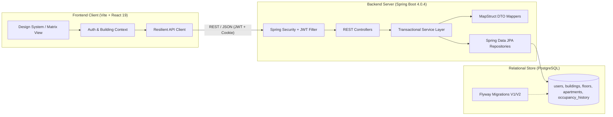

# BariLog (বাড়িলগ) — Smart Residential Operations & Management Platform

[](https://spring.io/projects/spring-boot)
[](https://openjdk.org/)
[](https://react.dev/)
[](https://vitejs.dev/)
[](https://www.postgresql.org/)
[](https://flywaydb.org/)
[]()

> **BariLog** is a centralized web platform for medium-to-large residential apartment buildings (typically 50–100+ units). It eliminates fragmented communication (WhatsApp groups, ad-hoc spreadsheets, paper gate registers) and provides an integrated, transparent, role-based platform for residents, committee managers, technicians, and security staff.

---

## Table of Contents
1. [Problem Statement & Vision](#problem-statement--vision)
2. [User Roles & Access Levels](#user-roles--access-levels)
3. [Architecture & Tech Stack](#architecture--tech-stack)
4. [Repository Structure](#repository-structure)
5. [Feature 01: Apartment Registry & Occupancy (Active)](#feature-01-apartment-registry--occupancy-active)
6. [20-Feature Collaborative Roadmap](#20-feature-collaborative-roadmap)
7. [Quick Start Guide](#quick-start-guide)
8. [Quick Usage Walkthrough](#quick-usage-walkthrough)
9. [API Reference & Sample Payloads](#api-reference--sample-payloads)
10. [Developer Guidelines for Future Features](#developer-guidelines-for-future-features)

---

## Problem Statement & Vision

In typical multi-family buildings with 50–100 flats:
- Residents discuss critical water/lift failures in unstructured WhatsApp groups where issues get buried.
- Managers track maintenance expenses and service charges in private spreadsheets, creating financial suspicion and disputes.
- Physical guest logs and parcel deliveries are handwritten in paper books, causing lost deliveries and security risks.
- Flat ownership, tenant turnover, and occupancy records are scattered across manual files.

**BariLog** solves this by offering a shared, auditable operational ledger where physical assets, occupancy states, financial transactions, maintenance SLAs, and security registers are recorded and verified in real-time.

---

## User Roles & Access Levels

The platform enforces strict Role-Based Access Control (RBAC) across both backend security filters and frontend UI components:

| Role | System Authority | Permissions & Responsibilities |
| :--- | :--- | :--- |
| **Building Manager / Committee** | `ROLE_MANAGER` | Full administrative control: manage buildings, floors, flats, occupancy transitions, service charges, budgets, maintenance task assignment, and official announcements. |
| **Resident / Apartment Tenant** | `ROLE_RESIDENT` | Read-only directory and building elevation view, personal flat details, maintenance ticket creation, bill payment viewing, receipts, visitor pass approvals, and facility reservations. |
| **Maintenance Staff / Vendor** | `ROLE_STAFF` | View assigned maintenance tickets, update repair progress, log materials and expenses, and upload completion proof. |
| **Security Personnel** | `ROLE_SECURITY` | Gatekeeper portal: verify visitor entry PINs, log delivery parcel intake and collection, and broadcast emergency incident alerts. |
| **System Administrator** | `ROLE_ADMIN` | Platform-wide administration, tenant onboarding, global configuration, and system-level audit logs. |

---

## Architecture & Tech Stack



### Backend
- **Framework**: Spring Boot 4.0.4 (Java 21 LTS)
- **Security**: Spring Security 7 stateless architecture with JJWT (0.12.6)
  - Short-lived signed JWT access token transmitted in the `Authorization: Bearer <token>` header.
  - Long-lived HttpOnly refresh token cookie for transparent session renewal.
- **Database Persistence**: Spring Data JPA / Hibernate ORM with PostgreSQL driver.
- **Database Migrations**: Flyway Community edition for deterministic, versioned SQL migrations (`V1__init_auth_schema.sql`, `V2__apartment_registry_schema.sql`).
- **Data Transfer**: MapStruct 1.6.2 and Project Lombok for compile-time boilerplate-free mapping.

### Frontend
- **Framework**: React 19 (SPA) with Vite 6.4 bundler.
- **Routing**: `react-router-dom` v7 with `ProtectedRoute` guards and role-gated action controls.
- **Design System**: Tailored architectural blueprint interface inspired by [DESIGN.md](file:///Users/ibrahim/Documents/Cse470%20project/CSE470-PROJECT-GROUP-2/DESIGN.md):
  - Primary Accent: Architectural Teal (`#0D9488`).
  - Surfaces: Slate dark background (`#0F172A`) and clean hairline borders (`#E2E8F0`).
  - Font: Plus Jakarta Sans / Inter with `tabular-nums` for precision metrics.
  - Icons: `lucide-react`.

---

## Repository Structure

```
CSE470-PROJECT-GROUP-2/
├── FEATURES.md                       # Comprehensive 20-feature specification
├── DESIGN.md                         # UI/UX design tokens & visual blueprint rules
├── README.md                         # Main documentation & developer onboarding
├── .gitignore                        # Global repository ignore rules (ignores .env)
│
├── Server/                           # Spring Boot Backend Project
│   ├── mvnw / mvnw.cmd               # Maven wrapper executable
│   ├── pom.xml                       # Maven build file (Spring Boot 4, Flyway, JJWT, Postgres)
│   ├── .env.example                  # Environment template (NO secrets)
│   ├── .gitignore                    # Backend-specific ignore rules
│   └── src/
│       ├── main/
│       │   ├── java/com/barilog/
│       │   │   ├── config/           # SecurityConfig, JwtConfig
│       │   │   ├── controllers/      # AuthController, UserController, BuildingController, ApartmentController
│       │   │   ├── dtos/             # Request & Response DTO records
│       │   │   ├── entities/         # User, Manager, Resident, Building, Floor, Apartment, OccupancyHistory
│       │   │   ├── exceptions/       # GlobalExceptionHandler, ResourceNotFound, DuplicateResource
│       │   │   ├── filters/          # JwtAuthenticationFilter
│       │   │   ├── mappers/          # MapStruct mappers (ApartmentMapper, BuildingMapper, UserMapper)
│       │   │   ├── repositories/     # Spring Data JPA interfaces
│       │   │   └── services/         # AuthService, BuildingService, ApartmentService, UserService
│       │   └── resources/
│       │       ├── application.yaml  # Spring configuration referencing env variables
│       │       └── db/migration/     # Flyway SQL schema scripts (V1, V2)
│       └── test/                     # Unit test suites (ApartmentServiceTest, BuildingServiceTest, AuthUnitTests)
│
└── Client/                           # React + Vite Frontend Project
    ├── package.json                  # Dependencies (React 19, react-router-dom, lucide-react)
    ├── vite.config.js                # Port 5173 with proxy /api -> http://localhost:8080
    ├── index.html                    # Root HTML document
    └── src/
        ├── components/
        │   ├── common/Logo.jsx       # SVG Ledger Facade brand mark
        │   ├── layout/               # AppLayout, Sidebar, Header
        │   ├── apartment/            # UnitSlideOver (specifications & audit trail drawer)
        │   └── modals/               # CreateBuildingModal, AddFloorModal, CreateApartmentModal, UpdateOccupancyModal
        ├── context/                  # AuthContext (login, logout, active user profile)
        ├── pages/
        │   ├── Auth/                 # Login.jsx, Register.jsx
        │   ├── Overview/             # Overview.jsx (Executive module console)
        │   └── ApartmentRegistry/    # ApartmentRegistry.jsx (Elevation matrix & table view)
        └── services/                 # api.js (Axios/Fetch wrapper with refresh interceptor)
```

---

## Feature 01: Apartment Registry & Occupancy (Active)

Feature 01 is fully functional across the backend and frontend:

1. **Building & Floor Hierarchy**:
   - Managers register buildings with physical addresses and total floor counts.
   - Floors support wing distinctions (`Main`, `East Wing`, `Tower A`) with duplicate floor protection.
2. **Physical Unit Specifications**:
   - Each apartment tracks gross square footage (`sizeSqft`), layout (`1 BHK`, `2 BHK`, `3 BHK`, `4 BHK`), bedrooms, bathrooms, balconies, utility meter numbers, and assigned parking bay IDs.
3. **Occupancy State Machine**:
   - Three distinct states:
     - `VACANT`: Empty unit available for lease or purchase.
     - `OWNER_OCCUPIED`: Registered owner resides in their own flat.
     - `RENTED`: Flat is actively occupied by a registered tenant user.
4. **Elevation Matrix View (Pattern A)**:
   - Visual floor-by-floor blueprint stacking highest floors on top.
   - Live color badges indicate occupancy (`Owner`, `Rented`, `Vacant`).
   - Units linked to the logged-in resident display a prominent `YOU` badge.
5. **Immutable Audit History**:
   - Every occupancy change generates an audit record in `occupancy_history` capturing the previous state, new state, user who made the change, effective transition date, and administrative notes.
6. **Deletion Guard**:
   - Occupied flats cannot be deleted (`400 Bad Request`). Units must first be transitioned to `VACANT` before removal.

---

## 20-Feature Collaborative Roadmap

| Module | # | Feature Title | Assignee | Status |
| :--- | :--- | :--- | :--- | :--- |
| **A. Apartment & Resident** | **01** | **Apartment Registry & Occupancy Management** | **Ibrahim** | **Completed** |
| | 02 | Resident and Tenancy Management | — | Planned |
| | 03 | Digital Document Repository | — | Planned |
| | **04** | **Resident Directory & Emergency Contacts** | **Ilham** | **In Progress** |
| **B. Finance & Transparency** | 05 | Automated Monthly Service Charge Generation | — | Planned |
| | 06 | Bill Payment & Digital Receipt Management | — | Planned |
| | 07 | Expense & Budget Category Tracking | — | Planned |
| | 08 | Financial Transparency Dashboard | — | Planned |
| **C. Maintenance & Resources** | 09 | Maintenance Complaint & Ticketing System | — | Planned |
| | 10 | Work Assignment & SLA Tracking | — | Planned |
| | 11 | Preventive Maintenance Scheduler | — | Planned |
| | 12 | Repair Vendor & Quotation Management | — | Planned |
| | 13 | Shared Facility Booking (Rooftop, Hall) | — | Planned |
| **D. Security & Community** | 14 | Visitor Pre-Approval & Entry Logs | — | Planned |
| | 15 | Parcel & Courier Delivery Register | — | Planned |
| | 16 | Notices, Resident Polls & Decisions | — | Planned |
| | 17 | Incident & Emergency Incident Broadcast | — | Planned |
| **E. Intelligence & Audit** | 18 | Smart Notifications & Multi-channel Reminders | — | Planned |
| | 19 | Building Performance Analytics | — | Planned |
| | 20 | Audit Trail & Dispute Resolution | — | Planned |

---

## Quick Start Guide

### Prerequisites
- **Java Development Kit (JDK)**: Version 21 LTS
- **Node.js**: Version 18+ and `npm`
- **PostgreSQL**: Version 14 or higher running on `localhost:5432`

---

### Step 1: Database Setup
Launch `psql` or pgAdmin and create the database:
```sql
CREATE DATABASE "bariLog";
```

---

### Step 2: Backend Configuration & Startup
1. Navigate to the `Server` directory:
   ```bash
   cd Server
   ```
2. Create your local `.env` configuration file from the template:
   ```bash
   cp .env.example .env
   ```
3. Edit `Server/.env` with your local PostgreSQL credentials:
   ```env
   # Base64-encoded 256-bit secret (generate with openssl rand -base64 32)
   JWT_SECRET=dGVzdFNlY3JldEtleUZvckJhcmlMb2dVbml0VGVzdHMyNTZiaXRzIQ==
   DB_URL=jdbc:postgresql://localhost:5432/bariLog
   DB_USERNAME=postgres
   DB_PASSWORD=your_postgres_password
   PORT=8080
   ```
4. Run the unit test suite to verify connectivity and business logic:
   ```bash
   ./mvnw test
   ```
5. Start the Spring Boot backend server:
   ```bash
   ./mvnw spring-boot:run
   ```
   *The server starts on `http://localhost:8080` and Flyway will automatically run all migrations (`V1` and `V2`).*

---

### Step 3: Frontend Client Startup
1. Open a new terminal and navigate to the `Client` directory:
   ```bash
   cd Client
   ```
2. Install dependencies:
   ```bash
   npm install
   ```
3. Start the Vite development server:
   ```bash
   npm run dev
   ```
   *The application will be live at `http://localhost:5173`.*

---

## Quick Usage Walkthrough

### 1. Manager Onboarding & Flat Creation
1. Open `http://localhost:5173/register` in your browser.
2. Fill out your name, email, password, and select **"Building Manager / Committee Member"**.
3. Sign in on the `/login` screen.
4. You will be greeted with the **Building Elevation View** on `/apartments`.
5. Click **"New Building"** → Name: `Green Valley Tower A`, Address: `Road 12, Banani`, Total Floors: `10`.
6. Click **"Add Floor"** → Floor: `1`, Wing: `Main`.
7. Click **"+ Register Apartment"** → Unit: `1A`, Gross Area: `1450 sqft`, Layout: `3 BHK`, Owner: `Mr. Rahim`, Status: `VACANT`.
8. The unit immediately appears in the elevation matrix. Click on unit `1A` to inspect its slide-over specs drawer.
9. Click **"Change Status"** inside the drawer → Change to `RENTED` or `OWNER_OCCUPIED`, specify effective transition date and reason notes.
10. The drawer instantly appends a new chronological entry to the **Occupancy Audit Trail**.

### 2. Resident Experience (Role-Gated)
1. Log out using the sidebar sign-out icon (redirects immediately to `/login`).
2. Register a second account with role **"Resident / Apartment Tenant"**.
3. Log in as the resident. Notice:
   - Administrative buttons (`New Building`, `Add Floor`, `Register Apartment`) are automatically hidden.
   - The header displays a **"Resident Access: View & Emergency Directory"** badge.
   - Opening an apartment drawer displays specifications in read-only mode with the **"Delete Unit"** and **"Change Status"** controls hidden.

---

## API Reference & Sample Payloads

All protected endpoints require the HTTP header:
`Authorization: Bearer <your_access_token>`

### 1. Authentication Endpoints

#### Register User
```bash
POST /api/users/register
Content-Type: application/json

{
  "name": "Sarah Ahmed",
  "email": "sarah@example.com",
  "password": "Password123!",
  "phoneNumber": "+8801700112233",
  "role": "MANAGER"  # MANAGER, RESIDENT, STAFF, SECURITY
}
```

#### User Login
```bash
POST /api/auth/login
Content-Type: application/json

{
  "email": "sarah@example.com",
  "password": "Password123!"
}
```
*Returns `{"accessToken": "..."}` and sets an HttpOnly `refreshToken` cookie.*

#### Revoke Session / Logout
```bash
DELETE /api/auth/logout
```
*Clears the HttpOnly refresh token cookie and revokes the token in the database.*

---

### 2. Feature 01 Endpoints

#### Register Building (Manager Only)
```bash
POST /api/buildings
Authorization: Bearer <token>
Content-Type: application/json

{
  "name": "Green Valley Tower",
  "address": "Block D, Bashundhara R/A",
  "totalFloors": 12
}
```

#### Add Floor Level (Manager Only)
```bash
POST /api/buildings/1/floors
Authorization: Bearer <token>
Content-Type: application/json

{
  "floorNumber": 4,
  "blockWing": "East Wing",
  "description": "4-unit residential layout"
}
```

#### Register Apartment (Manager Only)
```bash
POST /api/apartments
Authorization: Bearer <token>
Content-Type: application/json

{
  "buildingId": 1,
  "floorId": 1,
  "unitNumber": "4B",
  "sizeSqft": 1550.00,
  "netCarpetSqft": 1320.00,
  "bhkType": "3 BHK",
  "numberOfBedrooms": 3,
  "numberOfBathrooms": 3,
  "numberOfBalconies": 2,
  "parkingSlotNumber": "P-12",
  "utilityMeterNumber": "GAS-8821",
  "occupancyStatus": "VACANT",
  "ownerName": "Mrs. Farhana",
  "ownerPhone": "+8801811223344",
  "ownerEmail": "farhana@example.com"
}
```

#### Update Occupancy State (Manager Only)
```bash
PATCH /api/apartments/1/occupancy
Authorization: Bearer <token>
Content-Type: application/json

{
  "newStatus": "RENTED",
  "newResidentId": 4,
  "effectiveDate": "2026-12-01",
  "notes": "Lease agreement executed for 12 months with 2 months deposit."
}
```

#### Fetch Apartment Audit History
```bash
GET /api/apartments/1/history
Authorization: Bearer <token>
```

#### Delete Vacant Apartment (Manager Only)
```bash
DELETE /api/apartments/1
Authorization: Bearer <token>
```
*Returns `204 No Content`. If the flat is occupied, returns `400 Bad Request`.*

---

## Developer Guidelines for Future Features

When developing subsequent features (e.g., Feature 04 Resident Directory, Feature 05 Billing, Feature 09 Maintenance):

1. **Database Schema Evolution**:
   - Never modify committed migrations (`V1`, `V2`).
   - Create sequential Flyway migration files in `Server/src/main/resources/db/migration/` (e.g., `V3__maintenance_tickets.sql`).
   - Use snake_case for table and column names in PostgreSQL.
2. **DTO & Entity Separation**:
   - Entities (`entities/`) must never be exposed directly to controllers.
   - Create request/response DTOs in `dtos/request/` and `dtos/response/`.
   - Register MapStruct mappings in `mappers/`.
3. **Role Enforcement**:
   - Protect modifying endpoints using `@PreAuthorize("hasAnyRole('MANAGER', 'ADMIN')")`.
   - Protect staff/security endpoints using `@PreAuthorize("hasAnyRole('STAFF', 'MANAGER', 'ADMIN')")`.
4. **Environment & Credential Safety**:
   - **Never commit `.env` files** or hardcode secrets into `pom.xml` or `application.yaml`.
   - Always reference environment variables with sane local fallbacks: `${VARIABLE_NAME:default}`.
   - Update `Server/.env.example` if new environment keys are introduced.
5. **Frontend Styling Consistency**:
   - Adhere to the design system in [DESIGN.md](file:///Users/ibrahim/Documents/Cse470%20project/CSE470-PROJECT-GROUP-2/DESIGN.md).
   - Use CSS variables (`var(--brand-primary)`, `var(--bg-surface)`, `var(--border-hairline)`).
   - Use the `tabular-nums` class on numeric quantities and financial figures to maintain alignment.
