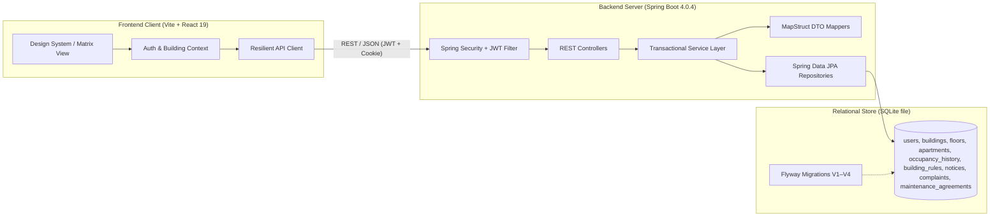

# BariLog (বাড়িলগ) — Smart Residential Operations & Management Platform

[](https://spring.io/projects/spring-boot)
[](https://openjdk.org/)
[](https://react.dev/)
[](https://vitejs.dev/)
[](https://www.sqlite.org/)
[](https://flywaydb.org/)
[]()

> **BariLog** aims to be a centralized web platform for medium-to-large residential apartment buildings (typically 50–100+ units). It eliminates fragmented communication (WhatsApp groups, ad-hoc spreadsheets, paper gate registers) and provides an integrated, transparent, role-based platform for residents, committee managers, technicians, and security staff.

**Documentation roles:** This README covers setup, current behavior, and API usage. [FEATURES.md](FEATURES.md) defines the full product scope and implementation gaps. [DESIGN.md](DESIGN.md) defines visual rules and labels future interface patterns.

**Status checked against source: 2026-11-18.** Authentication, apartment registry, and a structured document module exist. Finance, gate operations, and most of the 20-feature roadmap remain planned. “Implemented” below describes source coverage, not a runtime test result or production-readiness claim.

---

## Table of Contents

1. [Problem Statement & Vision](#problem-statement--vision)
2. [User Roles & Access Levels](#user-roles--access-levels)
3. [Architecture & Tech Stack](#architecture--tech-stack)
4. [Repository Structure](#repository-structure)
5. [Feature 01: Apartment Registry & Occupancy (Active)](#feature-01-apartment-registry--occupancy-active)
6. [Document Module (Feature 03: Partial)](#document-module-feature-03-partial)
7. [20-Feature Collaborative Roadmap](#20-feature-collaborative-roadmap)
8. [Quick Start Guide](#quick-start-guide)
9. [Quick Usage Walkthrough](#quick-usage-walkthrough)
10. [API Reference & Sample Payloads](#api-reference--sample-payloads)
11. [Developer Guidelines for Future Features](#developer-guidelines-for-future-features)

---

## Problem Statement & Vision

In typical multi-family buildings with 50–100 flats:
- Residents discuss critical water/lift failures in unstructured WhatsApp groups where issues get buried.
- Managers track maintenance expenses and service charges in private spreadsheets, creating financial suspicion and disputes.
- Physical guest logs and parcel deliveries are handwritten in paper books, causing lost deliveries and security risks.
- Flat ownership, tenant turnover, and occupancy records are scattered across manual files.

**BariLog** aims to solve this by offering a shared, auditable operational ledger where physical assets, occupancy states, financial transactions, maintenance SLAs, and security registers are recorded and verified in real-time.

---

## User Roles & Access Levels

The backend checks authentication and role permissions; the frontend hides restricted actions. The current sidebar is shared across roles. Broader intended responsibilities are in [FEATURES.md](FEATURES.md).

| Role | System Authority | Current behavior |
| :--- | :--- | :--- |
| **Building Manager / Committee** | `ROLE_MANAGER` | Create buildings/floors; create, edit, and delete vacant apartments; change occupancy; create rules; publish/delete notices; resolve complaints for managed buildings; add building maintenance agreements and acknowledge resident agreements. Managers cannot be assigned as apartment residents/tenants. |
| **Resident / Apartment Tenant** | `ROLE_RESIDENT` | Read registry data, rules, and active notices; submit/view own complaints; submit flat maintenance agreements and view building-wide plus own agreements. |
| **Maintenance Staff / Vendor** | `ROLE_STAFF` | Authenticated read access to registry, rules, and active notices; dedicated job queue is planned. |
| **Security Personnel** | `ROLE_SECURITY` | Authenticated read access to assigned building registry, emergency directory, rules, and active notices; gatekeeper portal is planned. |
| **System Administrator** | `ROLE_ADMIN` | Manager module actions plus user deletion and cross-building manager assignments through the API. |

`GET /api/users` is available to managers/admins. Registry reads and modifications enforce strict building authorization: managers only see buildings they manage, and querying another manager's building yields `403 Forbidden`. Document complaints and maintenance agreements are scoped to the manager's assigned buildings (`isResidentInManagedBuilding`); outsider managers cannot view complaints or resolve issues in other managers' buildings (`403 Forbidden`).

---

## Architecture & Tech Stack



### Backend
- **Framework**: Spring Boot 4.0.4 (Maven Java target: 17)
- **Security**: Spring Security stateless architecture with JJWT (API/impl 0.12.6; Jackson adapter 0.12.5)
  - Short-lived signed JWT access token transmitted in the `Authorization: Bearer <token>` header.
  - Long-lived HttpOnly refresh token cookie for transparent session renewal.
- **Database Persistence**: Spring Data JPA / Hibernate ORM with the SQLite JDBC driver; the database is a local `barilog.db` file relative to the backend process working directory (`Server/barilog.db` when started from `Server/`).
- **Database Migrations**: Flyway Community edition for deterministic, versioned SQL migrations (`V1__init_auth_schema.sql`, `V2__apartment_registry_schema.sql`, `V3__document_repository_schema.sql`). Migrations run automatically on startup and create the database file if it is missing.
- **Data Transfer**: MapStruct 1.6.2 and Project Lombok for compile-time boilerplate-free mapping.

### Frontend
- **Framework**: React 19 (SPA) with Vite 6 (`^6.2.0` in `Client/package.json`).
- **Routing**: `react-router-dom` v7 with `ProtectedRoute` guards and role-gated action controls.
- **Design System**: Tailored architectural blueprint interface inspired by [DESIGN.md](DESIGN.md):
  - Primary Accent: Architectural Teal (`#0D9488`).
  - Surfaces: Light canvas (`#F8FAFC`), white cards (`#FFFFFF`), slate text (`#0F172A`), and hairline borders (`#E2E8F0`).
  - Font: Plus Jakarta Sans / Inter with `tabular-nums` for precision metrics.
  - Icons: `lucide-react`.

---

## Repository Structure

```
BariLog/
├── FEATURES.md                       # Comprehensive 20-feature specification
├── DESIGN.md                         # UI/UX design tokens & visual blueprint rules
├── README.md                         # Main documentation & developer onboarding
├── .gitignore                        # Global repository ignore rules (ignores .env)
│
├── Server/                           # Spring Boot Backend Project
│   ├── mvnw / mvnw.cmd               # Maven wrapper executable
│   ├── pom.xml                       # Maven build file (Spring Boot 4, Flyway, JJWT, SQLite)
│   ├── .env.example                  # Environment template (NO secrets)
│   ├── .gitignore                    # Backend-specific ignore rules
│   └── src/
│       ├── main/
│       │   ├── java/com/barilog/
│       │   │   ├── config/           # SecurityConfig, JwtConfig
│       │   │   ├── controllers/      # AuthController, UserController, BuildingController, ApartmentController, DocumentController
│       │   │   ├── dtos/             # Request & Response DTO records
│       │   │   ├── entities/         # Users/roles, Building, Floor, Apartment, OccupancyHistory, document records
│       │   │   ├── exceptions/       # GlobalExceptionHandler, ResourceNotFound, DuplicateResource
│       │   │   ├── filters/          # JwtAuthenticationFilter
│       │   │   ├── mappers/          # MapStruct mappers (ApartmentMapper, BuildingMapper, UserMapper)
│       │   │   ├── repositories/     # Spring Data JPA interfaces
│       │   │   └── services/         # AuthService, BuildingService, ApartmentService, UserService, DocumentService
│       │   └── resources/
│       │       ├── application.yaml  # Spring configuration referencing env variables
│       │       └── db/migration/     # Flyway SQL schema scripts (V1–V4)
│       └── test/                     # Unit test suites (ApartmentServiceTest, BuildingServiceTest, AuthUnitTests)
│
└── Client/                           # React + Vite Frontend Project
    ├── package.json                  # Dependencies (React 19, react-router-dom, lucide-react)
    ├── vite.config.js                # Port 5173 with proxy /api -> http://localhost:8080
    ├── index.html                    # Root HTML document
    └── src/
        ├── components/
        │   ├── common/Logo.jsx       # SVG Ledger Facade brand mark
        │   ├── layout/               # AppLayout, Sidebar, Header
        │   ├── apartment/            # UnitSlideOver (specifications & audit trail drawer)
        │   └── modals/               # CreateBuildingModal, AddFloorModal, CreateApartmentModal, UpdateOccupancyModal
        ├── context/                  # AuthContext (login, logout, active user profile)
        ├── pages/
        │   ├── Auth/                 # Login.jsx, Register.jsx
        │   ├── Overview/             # Overview.jsx (Executive module console)
        │   ├── ApartmentRegistry/    # ApartmentRegistry.jsx (Elevation matrix & table view)
        │   └── DocumentRepository/   # Rules, notices, complaints, maintenance agreements
        └── services/                 # api.js (Fetch wrapper with a refresh-and-retry path)
```

---

## Feature 01: Apartment Registry & Occupancy (Active)

Feature 01 has backend and frontend implementations:

1. **Building & Floor Hierarchy**:
   - Managers register buildings with physical addresses and total floor counts.
   - Floors support wing distinctions (`Main`, `East Wing`, `Tower A`) with duplicate floor protection.
2. **Physical Unit Specifications**:
   - Each apartment tracks gross square footage (`sizeSqft`), layout (`1 BHK`, `2 BHK`, `3 BHK`, `4 BHK`), bedrooms, bathrooms, balconies, utility meter numbers, and assigned parking bay IDs.
3. **Occupancy State Machine**:
   - Three distinct states:
     - `VACANT`: Empty unit available for lease or purchase.
     - `OWNER_OCCUPIED`: Registered owner resides in their own flat.
     - `RENTED`: Flat is actively occupied by a registered tenant user.
4. **Elevation Matrix View (Pattern A)**:
   - Visual floor-by-floor blueprint stacking highest floors on top.
   - Color badges indicate the fetched occupancy (`Owner`, `Rented`, `Vacant`).
   - Units linked to the logged-in resident display a prominent `YOU` badge.
5. **Occupancy Audit History**:
   - Creation and the occupancy transition endpoint generate records in `occupancy_history`, capturing previous/new state, user, effective date, and notes. There is no history edit endpoint; deleting a vacant apartment cascades to its history, so this is not permanent audit retention.
6. **Deletion Guard**:
   - Occupied flats cannot be deleted (`400 Bad Request`). Units must first be transitioned to `VACANT` before removal.
7. **Manager Decoupling & Owner-Occupant Tracking**:
   - Managers and administrators cannot be assigned as apartment residents, owners, or tenants (`400 Bad Request: Building managers and administrators cannot be assigned as apartment residents`). This prevents role conflicts and audit pollution.
   - When a unit is transitioned to `OWNER_OCCUPIED` and no separate tenant is specified, the owner is tracked as the active resident for directory and emergency rosters.
8. **Multi-Building Isolation**:
   - Managers can only view and manage apartments in buildings explicitly assigned to them. Querying apartments, floors, or occupancy stats for another manager's building results in `403 Forbidden`.

---

## Document Module (Feature 03: Partial)

The `/documents` page and `/api/documents` endpoints store structured records in SQLite:

- **Building Rules:** authenticated users read; managers/admins create. V3 seeds 10 standard rules.
- **Notices:** managers/admins create, delete, and view all; other users read active notices. Categories: `GENERAL`, `URGENT`, `MAINTENANCE`, `EVENT`.
- **Complaints:** residents submit and view their own; managers/admins view complaints filed by residents living within their assigned buildings (`isResidentInManagedBuilding`). Resolving complaints for residents in other managers' buildings is rejected with `403 Forbidden` (`AccessDeniedException`). Statuses: `OPEN` → `RESOLVED`.
- **Maintenance Agreements:**
  - **Building-Level Contracts (Common Areas):** Created by building managers/admins for common infrastructure (elevators, standby generators, fire safety, water pumps). Automatically marked `NOTED` and visible to all building owners and residents for financial transparency, SLA verification, and auditing of service charge utilization.
  - **Flat-Level Contracts (Private Units):** Submitted by residents/owners for private in-unit contractor work (AC installation, carpentry, pest control) as `PENDING`. Managers review and acknowledge them (`NOTED`) so security and management are informed of external technicians on-premise.
  - Managers only see and acknowledge maintenance agreements belonging to their managed buildings.
- **Expiry reminders:** on-demand API query and page banner, default 30 days, maximum 365. Invalid windows below 1 use 30 days. Agreement results include already expired records; notices are restricted to the upcoming window.

The page has role-based tabs and per-user “new” markers stored in browser localStorage. These markers are not server-side read receipts. Complaints and maintenance agreements are strictly scoped to the manager's assigned buildings. General file upload/download, document access tiers, and background email/SMS/push delivery are not implemented.

---

## 20-Feature Collaborative Roadmap

Statuses describe this checkout. Existing assignees are retained. Partial implementations do not satisfy the full requirements in [FEATURES.md](FEATURES.md).

| Module | # | Feature Title | Assignee | Status |
| :--- | :--- | :--- | :--- | :--- |
| **A. Apartment & Resident** | **01** | **Apartment Registry & Occupancy Management** | **Ibrahim** | **Implemented** |
| | 02 | Resident and Tenancy Management | — | Partial: apartment/user links only |
| | 03 | Digital Document Repository | — | Partial: structured records; no file storage |
| | **04** | **Resident Directory & Emergency Contacts** | **Ilham** | **Implemented: directory, consent and emergency access** |
| **B. Finance & Transparency** | 05 | Automated Monthly Service Charge Generation | — | Planned |
| | 06 | Bill Payment & Digital Receipt Management | — | Planned |
| | 07 | Expense & Budget Category Tracking | — | Planned |
| | 08 | Financial Transparency Dashboard | — | Planned |
| **C. Maintenance & Resources** | 09 | Maintenance Complaint & Ticketing System | — | Partial: OPEN → RESOLVED only |
| | 10 | Work Assignment & SLA Tracking | — | Planned |
| | 11 | Preventive Maintenance Scheduler | — | Planned |
| | 12 | Repair Vendor & Quotation Management | — | Planned |
| | 13 | Shared Facility Booking (Rooftop, Hall) | — | Planned |
| **D. Security & Community** | 14 | Visitor Pre-Approval & Entry Logs | — | Planned |
| | 15 | Parcel & Courier Delivery Register | — | Planned |
| | 16 | Notices, Resident Polls & Decisions | — | Partial: notices only |
| | 17 | Incident & Emergency Incident Broadcast | — | Planned |
| **E. Intelligence & Audit** | 18 | Smart Notifications & Multi-channel Reminders | — | Partial: page expiry reminders only |
| | 19 | Building Performance Analytics | — | Partial: occupancy statistics only |
| | 20 | Audit Trail & Dispute Resolution | — | Partial: occupancy history only |

---

## Quick Start Guide

### Prerequisites
- **Java Development Kit (JDK)**: Version 17 or newer (Maven targets Java 17)
- **Node.js**: Version 18+ and `npm`
- **No database server needed.** SQLite is embedded; `Server/barilog.db` is created automatically on first run.

---

### Step 1: Backend Configuration & Startup

1. Navigate to the `Server` directory:
   ```bash
   cd Server
   ```
2. Create your local `.env` configuration file from the template:
   ```bash
   cp .env.example .env
   ```
3. Edit `Server/.env` and set a JWT secret:
   ```env
   # Base64-encoded 256-bit secret (generate with openssl rand -base64 32)
   JWT_SECRET=<paste-your-generated-base64-secret-here>
   PORT=8080
   ```
4. Run the unit test suite to verify business logic:
   ```bash
   ./mvnw test
   ```
5. Start the Spring Boot backend server:
   ```bash
   ./mvnw spring-boot:run
   ```

When run from `Server/`, Flyway creates `Server/barilog.db`, applies V1–V4, and seeds the 10 standard building rules. The server defaults to `http://localhost:8080`.

### Reset the local database

For a disposable local database only: stop the backend, back up anything needed, delete the database file used by that process, and start it again. This removes all local accounts and records. Flyway rebuilds V1–V4 and the 10 seed rules. Database files are git-ignored.

---

### Step 2: Frontend Client Startup

1. Open a new terminal and navigate to the `Client` directory:
   ```bash
   cd Client
   ```
2. Install dependencies:
   ```bash
   npm install
   ```
3. Start the Vite development server:
   ```bash
   npm run dev
   ```
   *The application will be live at `http://localhost:5173`.*

---

## Quick Usage Walkthrough

### 1. Manager Onboarding & Flat Creation

1. Use an existing trusted manager account; public registration creates resident accounts only.
2. Obtain that account through trusted local/administrator provisioning if none exists.
3. Sign in on the `/login` screen.
4. You will be greeted with the **Overview** dashboard on `/overview` (or click **Apartment Registry** on `/apartments`).
5. Click **"New Building"** → Name: `Green Valley Tower A`, Address: `Road 12, Banani`, Total Floors: `10`.
6. Click **"Add Floor"** → Floor: `1`, Wing: `Main`.
7. Click **"+ Register Apartment"** → Unit: `1A`, Gross Area: `1450 sqft`, Layout: `3 BHK`, Owner: `Mr. Rahim`, Status: `VACANT`. *(Note: Managers/admins cannot be selected as residents or tenants).*
8. The unit immediately appears in the elevation matrix. Click on unit `1A` to inspect its slide-over specs drawer.
9. Click **"Change Status"** inside the drawer → Change to `RENTED` or `OWNER_OCCUPIED`, specify effective transition date and reason notes. `RENTED` requires the user ID of an existing resident; register that account first.
10. The drawer instantly appends a new chronological entry to the **Occupancy Audit Trail**.

### 2. Resident Experience (Role-Gated)

1. Log out using the sidebar sign-out icon (redirects immediately to `/login`).
2. Register a second account; the public form creates a resident account.
3. Log in as the resident. Notice:
   - Administrative buttons (`New Building`, `Add Floor`, `Register Apartment`) are automatically hidden.
   - The header displays a **"Resident Access: View & Emergency Directory"** badge. Open `/directory` for the implemented directory and emergency contacts.
   - Opening an apartment drawer displays specifications in read-only mode with the **"Delete Unit"** and **"Change Status"** controls hidden.

---

## API Reference & Sample Payloads

All protected endpoints require the HTTP header:
`Authorization: Bearer <your_access_token>`

### 1. Authentication Endpoints

Use `GET /api/auth/refresh` with the refresh cookie to renew access, and `GET /api/auth/me` with an access token to retrieve the current profile.

#### Register User
```bash
POST /api/users/register
Content-Type: application/json

{
  "name": "Sarah Ahmed",
  "email": "sarah@example.com",
  "password": "Password123!",
  "phoneNumber": "+8801700112233",
  "role": "RESIDENT"
}
```

#### User Login
```bash
POST /api/auth/login
Content-Type: application/json

{
  "email": "sarah@example.com",
  "password": "Password123!"
}
```
*Returns `{"accessToken": "..."}` and sets an HttpOnly `refreshToken` cookie.*

#### Revoke Session / Logout
```bash
DELETE /api/auth/logout
```
*Clears the HttpOnly refresh token cookie and revokes the token in the database.*

---

### 2. Feature 01 Endpoints

#### Register Building (Manager/Admin)
```bash
POST /api/buildings
Authorization: Bearer <token>
Content-Type: application/json

{
  "name": "Green Valley Tower",
  "address": "Block D, Bashundhara R/A",
  "totalFloors": 12
}
```

#### Add Floor Level (Manager/Admin)
```bash
POST /api/buildings/1/floors
Authorization: Bearer <token>
Content-Type: application/json

{
  "floorNumber": 4,
  "blockWing": "East Wing",
  "description": "4-unit residential layout"
}
```

#### Register Apartment (Manager/Admin)
```bash
POST /api/apartments
Authorization: Bearer <token>
Content-Type: application/json

{
  "buildingId": 1,
  "floorId": 1,
  "unitNumber": "4B",
  "sizeSqft": 1550.00,
  "netCarpetSqft": 1320.00,
  "bhkType": "3 BHK",
  "numberOfBedrooms": 3,
  "numberOfBathrooms": 3,
  "numberOfBalconies": 2,
  "parkingSlotNumber": "P-12",
  "utilityMeterNumber": "GAS-8821",
  "occupancyStatus": "VACANT",
  "ownerName": "Mrs. Farhana",
  "ownerPhone": "+8801811223344",
  "ownerEmail": "farhana@example.com"
}
```

#### Update Occupancy State (Manager/Admin)
```bash
PATCH /api/apartments/1/occupancy
Authorization: Bearer <token>
Content-Type: application/json

{
  "newStatus": "RENTED",
  "newResidentId": 4,
  "effectiveDate": "2026-12-01",
  "notes": "Lease agreement executed for 12 months with 2 months deposit."
}
```

#### Fetch Apartment Audit History
```bash
GET /api/apartments/1/history
Authorization: Bearer <token>
```

#### Delete Vacant Apartment (Manager/Admin)
```bash
DELETE /api/apartments/1
Authorization: Bearer <token>
```
*Returns `204 No Content`. If the flat is occupied, returns `400 Bad Request`.*

---

### 3. Document Endpoints

All paths below start with `/api/documents`. All require authentication. Read results are scoped as described in the document module section; “authenticated” does not mean anonymous/public access.

| Method | Path | Access / behavior |
| :--- | :--- | :--- |
| GET | `/rules` | Authenticated: list rules |
| POST | `/rules` | Manager/admin: create rule |
| GET | `/notices` | Authenticated: active notices; managers/admins see all |
| POST | `/notices` | Manager/admin: publish notice |
| DELETE | `/notices/{id}` | Manager/admin: delete notice |
| GET | `/complaints` | Resident: own complaints; Manager: complaints from residents in managed buildings; Admin: all |
| POST | `/complaints` | Resident: create complaint |
| PATCH | `/complaints/{id}/resolve` | Manager/admin: resolve with `resolutionNote` (`403 Forbidden` for complaints outside manager's buildings) |
| GET | `/maintenance` | Resident/Owner: own submissions + building-wide contracts; Manager: agreements within managed buildings; Admin: all |
| POST | `/maintenance` | Resident/owner: submit flat agreement (`PENDING`); Manager/admin: submit building agreement (`NOTED`) |
| PATCH | `/maintenance/{id}/noted` | Manager/admin: acknowledge flat agreement (`403 Forbidden` outside manager's buildings) |
| GET | `/expiring?days=30` | Authenticated: filtered expiry reminder data |

Example resident complaint body for `POST /api/documents/complaints`:

```json
{
  "title": "Water leak in corridor",
  "description": "Water is pooling near the fourth-floor lift.",
  "category": "PLUMBING"
}
```

Example resolution body for `PATCH /api/documents/complaints/1/resolve`:

```json
{
  "resolutionNote": "Pipe repaired and corridor cleared."
}
```

Other registry reads: `GET /api/buildings`, `/api/buildings/{id}`, `/api/buildings/{id}/floors`, `/api/buildings/{id}/occupancy-stats`, `/api/apartments`, `/api/apartments/{id}`. Apartment list accepts `buildingId`, `floorId`, `status`, `residentId`, `ownerId`. The service uses ordered filter branches; these are not arbitrary combinable filters (only `buildingId` + `status` are combined). Managers/admins can edit specifications with `PUT /api/apartments/{id}`; use the dedicated occupancy endpoint for transitions and history.

---

## Developer Guidelines for Future Features

When developing subsequent features (e.g., Feature 04 Resident Directory, Feature 05 Billing, Feature 09 Maintenance):

1. **Database Schema Evolution**:
   - Don't make any changes to already-applied Flyway migration files (`V1`–`V3`).
   - Create sequential Flyway migration files in `Server/src/main/resources/db/migration/` (e.g., `V4__maintenance_tickets.sql`).
   - Use snake_case for table and column names in SQLite.
   - Resetting a disposable database replays migrations and deletes all local records; it is not a substitute for a new migration on shared databases.
   - SQLite cannot `ALTER TABLE ... ADD CONSTRAINT` or change a column type; such a change needs a new table + `INSERT INTO new SELECT ... FROM old` + rename, inside a new migration.
2. **DTO & Entity Separation**:
   - Entities (`entities/`) must never be exposed directly to controllers.
   - Create request/response DTOs in `dtos/request/` and `dtos/response/`.
   - Register MapStruct mappings in `mappers/`.
3. **Role Enforcement**:
   - Protect modifying endpoints using `@PreAuthorize("hasAnyRole('MANAGER', 'ADMIN')")`.
   - Protect staff/security endpoints using `@PreAuthorize("hasAnyRole('STAFF', 'MANAGER', 'ADMIN')")`.
4. **Environment & Credential Safety**:
   - **Never commit `.env` files** or hardcode secrets into `pom.xml` or `application.yaml`.
   - Require secrets through environment variables (`${JWT_SECRET}`); use local fallbacks only for non-secret settings such as `${PORT:8080}`.
   - Update `Server/.env.example` if new environment keys are introduced.
5. **Frontend Styling Consistency**:
   - Adhere to the design system in [DESIGN.md](DESIGN.md).
   - Use CSS variables (`var(--brand-primary)`, `var(--bg-surface)`, `var(--border-hairline)`).
   - Use the `tabular-nums` class on numeric quantities and financial figures to maintain alignment.


## Resident Directory (Feature 04)

Open `/directory` to search current residents in an authorized building. Residents control three independent sharing settings (`sharePhone`, `shareEmail`, `shareEmergencyDetails`), hidden from peers by default. Privacy settings can be viewed and saved through `GET|PUT /api/directory/me/preferences` or `GET|PUT /api/directory/privacy`. Managers/admins maintain optional emergency records; building managers and assigned security retain operational emergency access regardless of peer-sharing switches. Managers assign existing security account IDs to their own buildings; admins can associate a manager with a building. Existing apartment contact responses follow the same privacy rules.

Multi-building isolation guarantees that managers and security personnel can only view directories, resident rosters, and emergency details for buildings they have been assigned to. Registration requires phone number validation on both frontend and backend. Managers and administrators are strictly decoupled from apartment tenancy.

Directory API: `GET /api/directory/buildings`; `GET|PUT /api/directory/me/preferences` (and alias `GET|PUT /api/directory/privacy`); `GET /api/buildings/{id}/directory`; `GET|PUT /api/buildings/{id}/directory/{residentId}/emergency`; `GET /api/buildings/{id}/security-assignments`; `PUT|DELETE /api/buildings/{id}/security-assignments/{securityUserId}`; admin-only `PUT /api/buildings/{id}/manager` with `managerId`.

See [verification and usage](docs/verification/feature-04-resident-directory.md) for commands, tested scope, and manual acceptance checks.

Study the implementation with the [Feature 04 learning guide](docs/learning/feature-04-learning-guide.md), or its [rendered-diagram edition](docs/learning/feature-04-learning-guide-rendered.md). It includes source links, request flows, database relationships, privacy decisions, and exercises.
