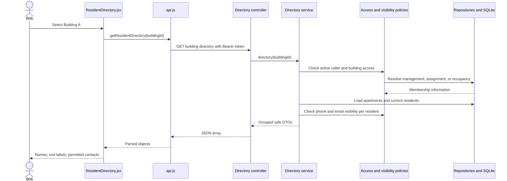
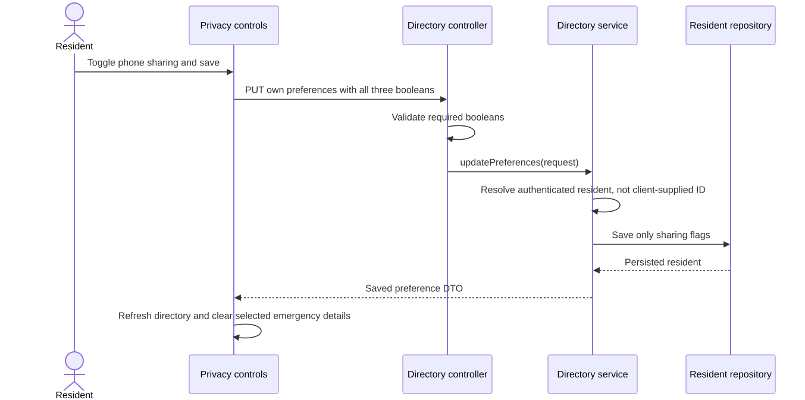
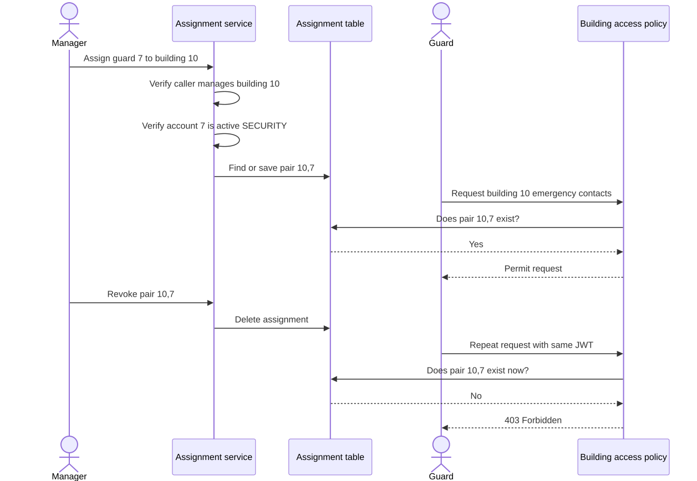
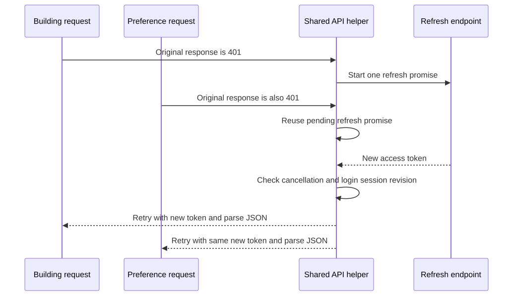

# Learn Feature 04: Resident Directory and Emergency Contacts — rendered diagrams

This guide follows the code currently in BariLog. Read it beside your editor: each lesson links to the implementation and gives you a small question to answer before moving on.

**Completion status:** The core Feature 04 implementation is present: directory search, separate resident sharing preferences, manager-maintained emergency records, assigned-security access, and privacy in existing apartment responses. Automated backend/client checks and a browser smoke test have passed. It has **not received a complete live browser-to-backend acceptance walkthrough**, physical mobile-device validation, or actual phone-dialing verification. “Implemented” does not mean every acceptance scenario or production concern has been verified. The implementation targets the `sqlite` branch; use Git history and `git status` to inspect the current commit state.

This edition uses pre-rendered SVG diagrams. The [editable Mermaid edition](feature-04-learning-guide.md) contains the diagram source. Source links use relative paths and `#L` line anchors, which work in repository viewers; in an editor that ignores line anchors, open the file and search for the named method.

## 1. What did we build?

Imagine Alice and Bob live in Building A, and Karim works there as a security guard.

- Bob can find Alice's name and apartment in the directory.
- Alice decides whether Bob sees her phone, email, and emergency details, using three independent switches.
- A manager enters Alice's emergency record. Alice can read it, but changes to the record go through management.
- The manager and Karim can access emergency details even when Alice hides them from neighbors.
- Karim can access Building A only after an authorized manager/admin assigns his account there.
- A security guard assigned only to Building B cannot access Building A by changing the URL.

Next-of-kin means Alice's chosen emergency contact, such as a parent, spouse, sibling, or trusted person. Physician means her regular doctor, if she chooses to provide one. Both contacts are optional, as is blood group. The emergency-sharing switch covers the **whole emergency profile**, including blood group.

### Who can do what?

| Person | Building boundary | Read emergency details | Edit emergency record | Change resident sharing flags |
| --- | --- | --- | --- | --- |
| Resident | Buildings where currently an active occupant | Own profile; peers' profiles when shared | No | Own only |
| Manager | Buildings managed by that account | Yes, regardless of sharing | Yes, within those buildings | No |
| Security | Explicitly assigned buildings | Yes, regardless of sharing | No | No |
| Admin | All buildings | Yes | Yes | No |
| Maintenance staff | No directory access | No | No | No |

The settings control **visibility**, not editing the account's actual phone/email. Updating account contact values is outside this feature.

## 2. Read these files in this order

| Order | Open this code | What to look for |
| --- | --- | --- |
| 1 | [Directory page](../../Client/src/pages/ResidentDirectory/ResidentDirectory.jsx#L12) | Which screen state loads which API? |
| 2 | [Directory API functions](../../Client/src/services/api.js#L246) | How a screen action becomes a URL and JSON body |
| 3 | [Directory controller](../../Server/src/main/java/com/barilog/controllers/ResidentDirectoryController.java#L10) | HTTP routes and request validation |
| 4 | [Directory service](../../Server/src/main/java/com/barilog/services/ResidentDirectoryService.java#L13) | How rows, preferences, and emergency responses are built |
| 5 | [Building access policy](../../Server/src/main/java/com/barilog/services/DirectoryAccessService.java#L10) | Whether the caller belongs to this building |
| 6 | [Contact visibility policy](../../Server/src/main/java/com/barilog/services/ContactVisibilityService.java#L8) | Which individual contact values may leave the server |
| 7 | [Resident entity](../../Server/src/main/java/com/barilog/entities/Resident.java#L15) and [V4 migration](../../Server/src/main/resources/db/migration/V4__resident_directory_schema.sql#L1) | How information is stored |
| 8 | [HTTP integration tests](../../Server/src/test/java/com/barilog/ResidentDirectoryApiTest.java#L21) | How we prove the rules using real security filters and SQLite |

### The architecture



A **DTO** is the object shaped for a request or response. An **entity** represents stored data. The service reads entities but returns DTOs, so private fields such as passwords or identity documents are not automatically serialized with directory results.

**Checkpoint:** If you hide a phone number with CSS but leave it in the response JSON, can someone still read it in the Network tab? Yes. That is why the visibility policy runs on the server.

## 3. Understand the database first

The system already had users, resident subclasses, buildings, floors, apartments, and some emergency fields. Feature 04 extends those records rather than creating a second resident database.



This diagram emphasizes the relationships used by Feature 04; it omits unrelated columns. The database's `manager_id` and `current_resident_id` reference users. The service enforces the expected role and active-occupancy rules; a foreign key alone does not express those rules.

### What V4 adds

| Already present | Added by Feature 04 |
| --- | --- |
| User phone/email | Three sharing flags, each false by default |
| Blood group | Next-of-kin relationship |
| Emergency name/phone | Physician name/phone |
| Building manager link | Building-to-security assignment table |
| Apartment current occupant | No duplicate directory-membership table |

From the [migration](../../Server/src/main/resources/db/migration/V4__resident_directory_schema.sql):

```sql
ALTER TABLE resident ADD COLUMN share_phone BOOLEAN NOT NULL DEFAULT 0;
```

This gives existing rows a hidden-by-default preference. The matching Java field also defaults to false for newly constructed objects. Flyway applies V4 on backend startup; changing an entity alone does not safely migrate existing records.

The assignment's combined key `(building_id, security_user_id)` means one guard/building pair can occur only once. A guard can have several different building pairs. Deleting the building or security record removes its assignment rows through foreign-key cascading.

Open [BuildingSecurityAssignment](../../Server/src/main/java/com/barilog/entities/BuildingSecurityAssignment.java#L11) and [its embedded ID](../../Server/src/main/java/com/barilog/entities/BuildingSecurityAssignmentId.java#L13). `@EmbeddedId` models that pair; `@MapsId` connects each ID component to its entity relationship.

**Checkpoint:** A guard has `(10, 7)` and `(20, 7)`. Removing `(10, 7)` removes Building 10 access while keeping Building 20 access.

## 4. Who counts as a resident of a building?

The directory derives membership from current occupancy. It does not use a separate list that can become outdated.

An apartment qualifies only when it is active, non-vacant, and linked to an active `Resident`. An owner link alone is insufficient: someone can own an apartment without living there. Multiple qualifying apartments produce one resident row with several unit labels.

Open [eligible(Apartment)](../../Server/src/main/java/com/barilog/services/DirectoryAccessService.java#L20) and [directory(buildingId)](../../Server/src/main/java/com/barilog/services/ResidentDirectoryService.java#L30).



The caller comes from [AuthService.getLoggedUser()](../../Server/src/main/java/com/barilog/services/AuthService.java#L16), using the authenticated user ID placed in the security context by [JwtAuthenticationFilter](../../Server/src/main/java/com/barilog/filters/JwtAuthenticationFilter.java#L28). A client cannot supply another actor ID to become that person.

You will see `Hibernate.unproxy(...)` before some subtype checks. Lazy-loaded user relationships may be proxy objects; unproxying lets the code reliably determine whether the actual account is a `Resident`.

**Checkpoint:** Why does moving out remove building access without editing a separate directory membership record? Because every request checks current eligible occupancy.

## 5. Trace one directory request

Suppose Bob opens Building A in the page header.



Inside `directory()`, a `LinkedHashMap` groups apartments by resident ID. `computeIfAbsent` creates a resident row once. Each qualifying apartment adds another unit object. Results are sorted by resident name, then ID.

The list deliberately excludes emergency profile fields. Clicking **Emergency contacts** makes a separate request and checks access again. Search runs over the already authorized names/unit labels in React, rather than querying every resident in the platform.

**Checkpoint:** Alice occupies units 1A and 2B in Building A. Expect one directory row, containing two entries in `units`.

## 6. Understand field visibility

Building access and field visibility answer different questions. Bob can belong to Building A while still being unable to see Alice's phone.

Open [allowed(...)](../../Server/src/main/java/com/barilog/services/ContactVisibilityService.java#L10) and the three `maySee...` methods beside it.



The simplified rule is:

```text
active caller AND
(self OR (building access AND (relevant consent OR authorized management/security)))
```

The emergency endpoint additionally resolves the subject as a current eligible occupant **inside the requested building** before returning their profile.

### Hidden and missing are different

| Response state | Meaning | Value sent |
| --- | --- | --- |
| `HIDDEN` | This caller cannot see it | `null` |
| `NOT_PROVIDED` | Caller is allowed, but no value is recorded | `null` |
| `VISIBLE` | Caller is allowed and a value/profile exists | Recorded values |

A hidden profile must not reveal whether emergency information is recorded. For an allowed emergency response, individual fields can still be null; the overall state becomes `NOT_PROVIDED` only when all six emergency values are null.

Illustrative phone/email response for Bob viewing Alice with phone sharing on and email sharing off:

```json
{
  "residentId": 12,
  "name": "Alice",
  "units": [{"apartmentId": 9, "unitNumber": "1A", "floorNumber": 1, "blockWing": "Main"}],
  "phoneNumber": "+8801700112233",
  "phoneVisibility": "VISIBLE",
  "email": null,
  "emailVisibility": "HIDDEN"
}
```

Open [DirectoryResidentResponse](../../Server/src/main/java/com/barilog/dtos/response/DirectoryResidentResponse.java#L3) and [EmergencyContactResponse](../../Server/src/main/java/com/barilog/dtos/response/EmergencyContactResponse.java#L3) to compare their fields.

**Checkpoint:** Turning on `sharePhone` changes neither `shareEmail` nor `shareEmergencyContacts`.

## 7. Saving privacy versus saving an emergency record

These are separate operations with different owners.

| Operation | Who owns it? | What changes? |
| --- | --- | --- |
| Save preferences | Authenticated resident | Three sharing flags |
| Save emergency record | Own-building manager/admin | Six optional emergency values |
| Edit actual user phone/email | Outside Feature 04 | No endpoint added here |



Preference request example:

```json
{"sharePhone": true, "shareEmail": false, "shareEmergencyContacts": false}
```

The fields are boxed `Boolean` values with `@NotNull` in [DirectoryPreferencesRequest](../../Server/src/main/java/com/barilog/dtos/request/DirectoryPreferencesRequest.java#L4). Omitting a setting is invalid; it must not silently reset consent.

Manager emergency request example:

```json
{
  "bloodGroup": "O+",
  "emergencyContactName": "Parent",
  "emergencyContactRelationship": "Mother",
  "emergencyContactPhone": "01700000000",
  "physicianName": null,
  "physicianPhone": null
}
```

Open [updateEmergency(...)](../../Server/src/main/java/com/barilog/services/ResidentDirectoryService.java#L57). It checks management access, verifies the target lives in that building, trims optional strings, validates blood group and paired contact values, then saves. The transaction keeps this write together. This is replacement behavior: omitted/blank optional values become null. Send the whole desired emergency record when updating it.

| Validation | Exact rule |
| --- | --- |
| Blood group | A+, A-, B+, B-, AB+, AB-, O+, O-, or absent |
| Contact/physician name | Up to 150 characters |
| Contact/physician phone | String, up to 30 characters; preserve international formatting |
| Relationship | Up to 50 characters; requires a next-of-kin pair |
| Contact pair | Both name and phone, or neither |
| Clear record | Submit all optional values blank/null |

**Checkpoint:** A manager saving blood group must not alter the resident's consent flags; the emergency request DTO contains no sharing fields.

## 8. Assigning security and revoking access

Assignment links an existing security account to a building. It does not create an account or change its role.

Open [assign(...)](../../Server/src/main/java/com/barilog/services/BuildingSecurityAssignmentService.java#L21) and [assignment repository](../../Server/src/main/java/com/barilog/repositories/BuildingSecurityAssignmentRepository.java#L5).



An ordinary repeated assignment returns the existing record. The combined database key prevents duplicate stored rows. This does not constitute a tested guarantee for simultaneous assignment requests from multiple browsers.

Revocation takes effect at the next server access. It cannot remove information a guard already saw or copied. The current page refreshes on focus; no push transport immediately erases an already displayed profile in another browser.

Only an admin can associate a manager with a building through `assignManager()`. Managers cannot claim arbitrary buildings. Existing unassigned buildings need that admin association; new manager-created buildings default to that manager.

**Checkpoint:** A valid `SECURITY` JWT proves a role. The database assignment supplies the building permission, so revocation needs no replacement JWT.

## 9. The API map

All endpoints require authentication. All paths start with `/api`.

| Method | Path after `/api` | Main service method |
| --- | --- | --- |
| GET | `/directory/buildings` | `buildings()` |
| GET | `/buildings/{id}/directory` | `directory(id)` |
| GET / PUT | `/directory/me/preferences` or `/directory/privacy` | `preferences()` / `updatePreferences()` |
| GET / PUT | `/buildings/{id}/directory/{residentId}/emergency` | `emergency()` / `updateEmergency()` |
| GET | `/buildings/{id}/security-assignments` | `list()` |
| PUT / DELETE | `/buildings/{id}/security-assignments/{securityUserId}` | `assign()` / `revoke()` |
| PUT | `/buildings/{id}/manager` | `assignManager()` with `{ "managerId": 4 }` |

Browse [assignment controller](../../Server/src/main/java/com/barilog/controllers/BuildingSecurityAssignmentController.java#L10) alongside the [directory controller](../../Server/src/main/java/com/barilog/controllers/ResidentDirectoryController.java).

| HTTP status | Read it as |
| --- | --- |
| 200 | Successful read/save; JSON returned |
| 204 | Successful revoke; no JSON body |
| 400 | Invalid request, such as a missing preference or invalid blood group |
| 401 | Missing/invalid authentication |
| 403 | Authenticated caller lacks permission |
| 404 | Building missing, or target not currently present within an authorized building |

[GlobalExceptionHandler](../../Server/src/main/java/com/barilog/exceptions/GlobalExceptionHandler.java#L17) translates service/validation errors into HTTP responses. A caller denied building access must be rejected before fetching another building's target resident details.

## 10. Why existing code changed too

### Apartment responses

Before Feature 04, apartment responses could expose owner/occupant contact values directly. A private directory would accomplish little if an apartment API still returned the same hidden data.

[ApartmentService.response(...)](../../Server/src/main/java/com/barilog/services/ApartmentService.java#L35) maps an apartment to a DTO and then calls `redactApartment(...)`. This applies to list/detail and create/update/occupancy responses. Security list queries intersect their building assignments; direct registry reads check the building. Manager registry writes are limited to managed buildings.

For peer owner contacts, manually entered owner details are not evidence of consent. The implementation only permits a linked eligible resident-owner's current account contact when their setting allows it. Authorized management/security can view operational owner information; an owner can see their own owner details.

### User listing and registration

[UserService.getAllUsers()](../../Server/src/main/java/com/barilog/services/UserService.java#L88) strips other users' email/phone and extra profile metadata from manager-facing listing responses; admin listings retain full DTOs. This does not redefine every existing user response across the platform.

Public registration is now resident-only. Otherwise anybody could register as an admin and bypass directory restrictions. See [register(...)](../../Server/src/main/java/com/barilog/services/UserService.java#L35) and [the registration screen](../../Client/src/pages/Auth/Register.jsx#L7). Existing privileged accounts still sign in; creating trusted privileged accounts on a new installation needs a separate provisioning process.

### Resident hydration and browser caching

[ResidentRepository](../../Server/src/main/java/com/barilog/repositories/ResidentRepository.java#L4) now inherits JPA loading. Its old native queries selected only some columns, omitting profile information. [DirectoryPrivacyHeadersFilter](../../Server/src/main/java/com/barilog/filters/DirectoryPrivacyHeadersFilter.java#L8) adds `Cache-Control: no-store` to API responses.

**Checkpoint:** Explain why a backend response mapper is not sufficient by itself: mapping chooses fields, but permission checks decide whether values may be revealed to this caller.

## 11. How the React screen avoids stale data

The UI implementation is in one page file with small local `Contact`, `Assignments`, and `ManagerAssignment` functions. The earlier plan proposed more separate component files; those files were not created. Follow the actual code links here, rather than looking for a nonexistent `EmergencyContactPanel.jsx`.

[AppLayout](../../Client/src/components/layout/AppLayout.jsx#L8) loads the directory's authorized building list for the header while on `/directory`. [App.jsx](../../Client/src/App.jsx#L52) registers the route. Sidebar and overview link to it for permitted roles.

Inside the directory page:

| State | What it represents |
| --- | --- |
| `result` | Directory rows tagged with a user/building key |
| `prefs` | Resident's three sharing settings |
| `selected` | Selected resident and the key they were selected under |
| `detail` | Emergency response tagged by key and resident ID |
| `draft` | Editable emergency form values |
| `revision` | Triggers a directory reload after save/focus |



The key is built like this:

```javascript
const key = `${user?.id}:${selectedBuildingId}`;
const rows = result?.key === key ? result.rows : [];
```

The emergency display also checks resident ID, preventing Alice's record from appearing under Bob's heading. `AbortController` cancels old fetches during effect cleanup. Save results carry their originating key, and profiles are cleared/reloaded after relevant actions. These checks reduce stale display risks; the full rapid-switch/multi-browser acceptance matrix is not yet signed off.

The browser does not persist directory or emergency data in localStorage. The pre-existing authentication token storage is a separate concern and remains in use.

**Checkpoint:** Clearing the old data once is insufficient if an old request can arrive afterward. Explain what the abort and display-key checks each contribute.

## 12. Why the token-refresh fix matters

Opening the directory can start building and preference requests together. If the access token expires, both can receive 401. They should share a refresh request rather than treat a token renewal as a different login session.

Open [refreshAccessToken()](../../Client/src/services/api.js#L22) and [apiFetch()](../../Client/src/services/api.js#L31).



`refreshPromise` shares the pending refresh. `sessionVersion` changes on explicit token/session changes such as login/logout; normal internal renewal does not increment it. This protects logout from a delayed refresh restoring an old session. Retry responses still go through normal status/error/204/JSON handling.

**Checkpoint:** A raw `Response` object is not a resident array. That is why the retry must return parsed JSON just like the original request path.

## 13. Read the tests as worked examples

| Test file | What you learn |
| --- | --- |
| [DirectoryPrivacyTest](../../Server/src/test/java/com/barilog/DirectoryPrivacyTest.java#L7) | Independent consent flags, self access, unrelated-building denial |
| [ResidentDirectoryPersistenceTest](../../Server/src/test/java/com/barilog/ResidentDirectoryPersistenceTest.java#L8) | Existing V3 data survives V4; false defaults, unique assignments, cascading deletion, repeat migrations |
| [ResidentDirectoryApiTest](../../Server/src/test/java/com/barilog/ResidentDirectoryApiTest.java#L21) | Real filters/controllers/services/JPA against temporary SQLite; fake test JWTs, actual permission outcomes |
| [api.test.js](../../Client/src/services/api.test.js#L1) | Retry parsing, 204, error messages, logout race, concurrent refresh |
| [Browser smoke script](../../Client/scripts/verify-directory-browser.mjs#L1) | Real React rendering in Chrome with mocked API responses |

The backend tests seed fictional accounts directly through repositories, then generate JWTs. They do not reopen privileged public registration to create fixtures. The tests isolate database files and do not reset the user's application database.

From `Server/`:

```bash
./mvnw test
```

From `Client/`:

```bash
node --test src/services/api.test.js
npm run build
```

The latest recorded suite contains **17 backend tests and five client transport tests**. A green build confirms compilation/bundling; it does not prove a complete live user journey. See the [verification guide](../verification/feature-04-resident-directory.md) for browser commands, evidence, and the remaining acceptance work.

## 14. Try these learning exercises

Use fictional data in a disposable development environment. Keep trusted existing manager/security accounts available; public signup creates residents only.

1. **Trace Bob viewing Alice.** Open the Network tab, inspect the directory JSON, then find the matching `directory()` and `maySeePhone()` code. Predict the result before changing a flag.
2. **Toggle only phone sharing.** Save Alice's preferences. On Bob's next fetch, expect phone visible while email/emergency remain hidden. Alice still sees her own record.
3. **Read as a guard.** Assign a guard to A, request A and B, then revoke A. Reuse the same guard token: the next A request should be forbidden.
4. **Try an invalid emergency update.** Send physician name without phone. Expect 400 and unchanged stored data. Then send both and expect success as the building manager.
5. **Move out.** Vacate a resident's last unit in A. The next directory access to A should be denied, while access to a separately occupied B remains.
6. **Look for privacy bypasses.** Compare directory JSON with apartment-list/detail JSON as a peer. Hidden contact values should not reappear through those routes.

After each exercise, explain which layer made the decision. Was it React display state, controller validation, building access, contact visibility, or a database constraint?

## 15. Find the right file when you change something later

| Desired change | Start here |
| --- | --- |
| Change who belongs to a building | `DirectoryAccessService.eligible()` and `canReadBuilding()` |
| Change which contacts a viewer sees | `ContactVisibilityService` |
| Add another emergency field | New Flyway migration, entity, request/response DTOs, service mapping/validation, React form, relevant tests |
| Change sharing preferences | Resident fields, preference DTOs, service, visibility policy, React switches |
| Change guard assignment rules | `BuildingSecurityAssignmentService` and its access checks |
| Change display/search | `ResidentDirectory.jsx` and [its stylesheet](../../Client/src/pages/ResidentDirectory/ResidentDirectory.css) |
| Investigate expired-token failures | `apiFetch()`, shared refresh, and `api.test.js` |
| Investigate hidden contacts in an apartment drawer | `ApartmentService.response()` then `redactApartment()` |

Use the [feature spec](../superpowers/specs/2026-11-18-resident-directory-design.md) for intended behavior, the [implementation plan](../superpowers/plans/2026-11-18-resident-directory.md) for the teaching sequence, and the [execution notes](../superpowers/plans/2026-11-18-resident-directory-execution.md) for what was actually implemented. This guide explains that implementation; it does not introduce additional product features.
